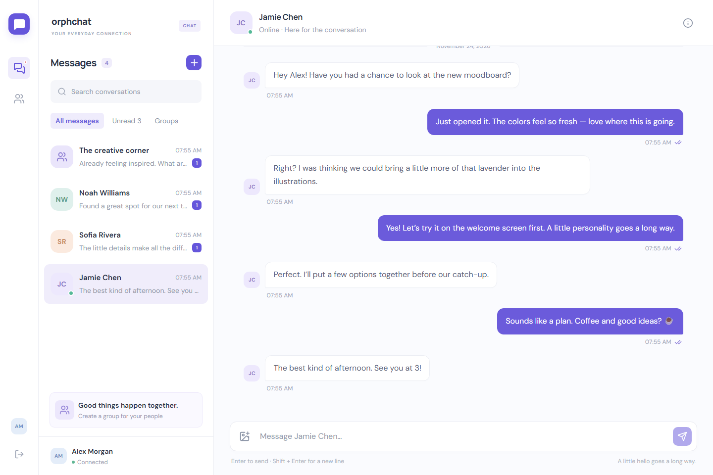
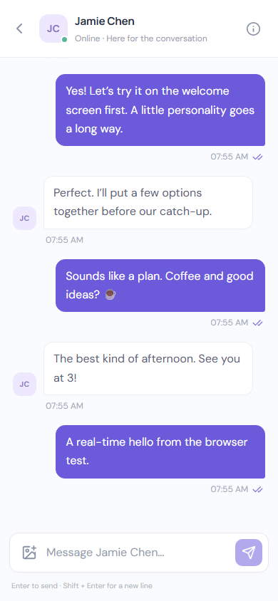

# orphchat

A complete React/Vite + Express/Mongoose + MongoDB + Socket.io chat application built from all five modules of the nine-page Sapphire IQ guide. Includes private conversations, groups, persisted and paginated history, images, presence, typing, unread counts and read receipts.

## Running locally

Screenshots below show the real app running locally against seeded MongoDB data. The desktop view uses two signed-in browser sessions to demonstrate online presence and read receipts. No live deployment is required.





## Run locally

Requirements: **Node 22.12+**, npm, and **MongoDB Atlas or a MongoDB replica set**. Transactions require a replica set; standalone MongoDB will not work.

```sh
git clone https://github.com/orpheusdark/sapp-chat.git
cd sapp-chat
npm ci
cp backend/.env.example backend/.env
cp frontend/.env.example frontend/.env
```

On PowerShell, `Copy-Item backend/.env.example backend/.env` and `Copy-Item frontend/.env.example frontend/.env` also work. Edit `backend/.env`:

- Set `MONGODB_URI` to your Atlas URI with a database name. Allow your development machine's IP in Atlas and create a database user scoped to this database.
- Replace `JWT_SECRET` with a random secret. Generate one with `node -e "console.log(require('crypto').randomBytes(48).toString('base64url'))"`.
- Keep both local frontend origins from the example. Origins must be exact, without trailing slashes.
- For images, set all three `CLOUDINARY_*` values from your Cloudinary dashboard. These secrets belong **only on the backend**, never in `VITE_` settings.

Alternatively, start a persistent local replica set with Docker:

```sh
docker compose up -d --wait
```

The example local database URI matches this replica set. Its port is bound only to loopback, and the named volume retains data across restarts.

```sh
npm run dev
```

Open **http://localhost:5173**. API: port 4000. Register two accounts in separate browser profiles or seed demo accounts below. `frontend/.env` uses `VITE_API_URL` as the backend **origin**, without `/api`. Restart Vite after editing it.

## Optional demo data

Set `SEED_PASSWORD` in `backend/.env` to at least 12 characters, then run:

```sh
npm run seed
```

Sign in as `alex@orphchat.test`, `jamie@orphchat.test`, `sofia@orphchat.test`, or `noah@orphchat.test` with your seed password. The seed adds private chats, a four-person group and example messages. Re-running does not delete data or change existing passwords. Demo seeding is disabled in production.

## Features

- JWT registration/login, bcrypt hashing, protected client/API routes, session expiry and logout.
- User search by name/email; canonical unique member-pair keys prevent duplicate private chats under concurrent creation.
- Groups of 3–100 people; members can send, creator/admin alone can add people. Existing sockets immediately join new group rooms.
- REST and socket text sends share a transaction-backed service. UUID retry keys prevent duplicate records and duplicate broadcasts. Database commit always precedes emit.
- Membership checks protect history, sends, reads, images and socket join/typing/send actions. Sender identity comes from the token.
- Stable sequence-based older-history pagination and forward catch-up across long disconnects. REST responses and socket echoes reconcile by database ID.
- Multi-tab presence, expiring typing, per-member persisted read watermarks, per-conversation unread counts and read receipts.
- JPEG/PNG/WebP/GIF sharing through Multer and Cloudinary, up to 5 MB. Content signatures are checked, SVG rejected and image decoding performed by Cloudinary. Only server-generated media metadata is stored.
- Responsive desktop/mobile UI, image preview, older-history control, loading/empty/error states, keyboard forms, focus-contained dialogs and reduced-motion support.

## Tests and build

```sh
npm test
npm run build
npx playwright install chromium
npm run test:e2e
```

Database tests download a temporary MongoDB binary on first run and need internet, local process and loopback access. They never use your configured production database.

- Backend integration tests use a real disposable replica set and real Socket.io clients. Coverage includes auth, search, CORS, permissions, concurrent chat creation/retries, pagination, save-before-emit/rollback, typing, multi-socket presence, unread/read state, group administration and image validation/limits.
- Frontend tests cover reconciliation, labels, API headers, multipart requests and protected-route/login errors.
- Browser verification uses two independent sessions for live messaging, typing, unread clearing, group creation/addition, images, reconnect across 36 missed messages, refresh/history, mobile navigation and logout. Screenshots go to ignored `artifacts/`.

Cloudinary storage is **stubbed in automated tests**; upload parsing, validation, persistence, sockets and rendering are real. Live Cloudinary delivery needs your credentials. GitHub Actions runs tests/build/browser verification on pushes and pull requests.

## Deployment and documentation

Root `vercel.json` and `render.yaml` configure a **Vercel static frontend + Render WebSocket backend**. See [deployment](docs/deployment.md), [API/events](docs/api.md), [architecture](docs/architecture.md), [PDF requirements](docs/requirements.md), and [validation](docs/validation.md). No live deployment is assumed or claimed.

```text
backend/src/       config, models, auth, API, chat service, sockets, images, seed
backend/test/      MongoDB + real socket integration tests
frontend/src/     protected routes, auth, chat UI, API helpers, tests
scripts/e2e.mjs   disposable two-user browser verification
docs/             requirements, API, architecture, deployment, validation
```

## Operating limits

This is a single-backend-instance project. Presence, typing, socket rooms and rate limits are process-local. Add a Socket.io Redis adapter, shared presence/rate-limit storage and load-balancer configuration before horizontal scaling. Database messages and reads survive restarts; ephemeral presence/typing do not.

JWTs are held in sessionStorage; XSS prevention remains important. React renders text without raw HTML. Logout clears the local token and closes its socket; there is no global token revocation, password reset or end-to-end encryption. Sockets disconnect at JWT expiry.

Cloudinary HTTPS image URLs are accessible to anyone who knows the URL. For stricter private media, use authenticated delivery with short-lived signed URLs. Failed/duplicate DB writes attempt cloud cleanup, but a process crash between upload and commit can orphan an image; periodically reconcile the application's Cloudinary folder. Commit-then-emit is not a durable event outbox; reconnect/visibility catch-up retrieves messages saved before a broadcast failure.

User search returns at most 20 results. The conversation list is loaded for the signed-in member. New group members can view existing history, but their unread watermark begins at addition time. A group read check means at least one other member has read the message.
